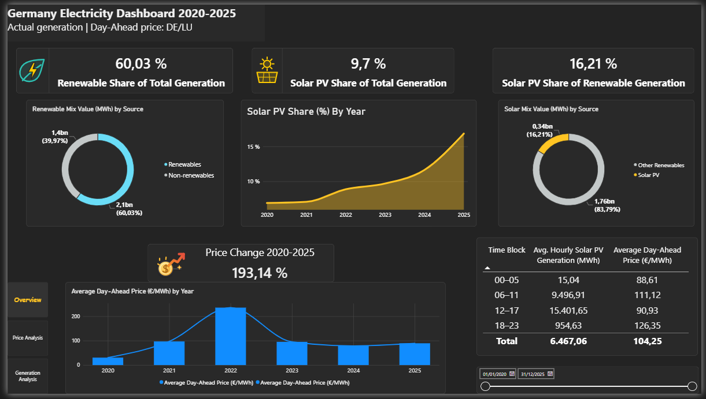
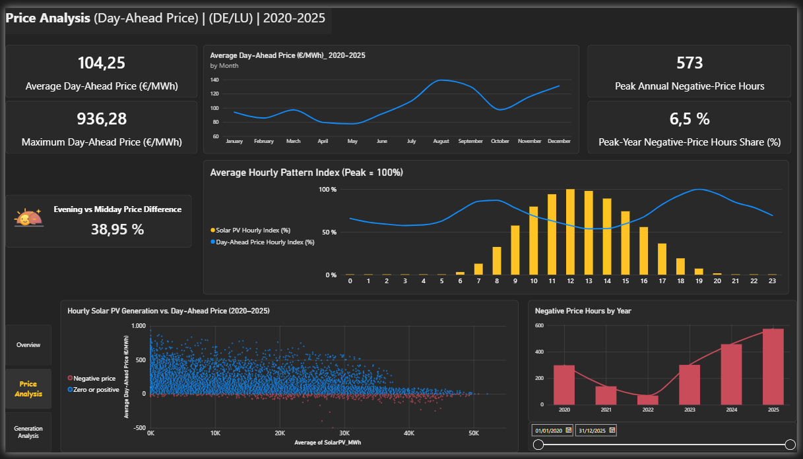
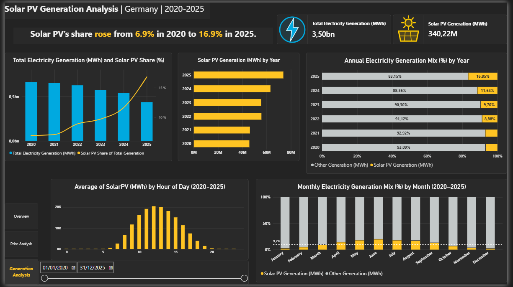

# Germany Electricity Dashboard (2020–2025)

A Power BI dashboard exploring Germany's actual electricity generation and day-ahead wholesale electricity prices in the Germany/Luxembourg (DE/LU) bidding zone, based on hourly data for 2020–2025.

## Key results

The figures below are for the full period 2020–2025 unless a different period is stated.

| Indicator | Value | Period / note |
|---|---|---|
| Renewable share of total generation | 60.03% | 2020–2025 |
| Renewable vs. non-renewable generation | 2.1 bn MWh vs. 1.4 bn MWh | 2020–2025 |
| Solar PV share of total generation | 9.7% | 2020–2025 |
| Solar PV share of renewable generation | 16.21% (0.34 bn MWh of 2.1 bn MWh) | 2020–2025 |
| Solar PV share of total generation, annual | 6.9% (2020) to 16.9% (2025) | Rounded; 2025 is 16.85% unrounded |
| Average day-ahead price (DE/LU) | €104.25/MWh | 2020–2025 |
| Maximum day-ahead price | €936.28/MWh | 12 December 2024, 17:00–18:00 |
| Change in average annual day-ahead price | +193.14% | 2020 vs. 2025 |
| Evening vs. midday price difference | +38.95% | Hours 18–23 vs. 12–17 |
| Negative-price hours | 1,837 (3.5% of all hours) | 2020–2025 |
| Peak annual negative-price hours | 573 (6.5% of hours) | 2025 |

### Solar output and price by time block

| Time block | Avg. hourly Solar PV generation (MWh) | Avg. day-ahead price (€/MWh) |
|---|---|---|
| 00–05 | 15.04 | 88.61 |
| 06–11 | 9,496.91 | 111.12 |
| 12–17 | 15,401.65 | 90.93 |
| 18–23 | 954.63 | 126.35 |

Solar output peaks around hour 12, while the average day-ahead price peaks around hour 19. Prices are therefore highest in the evening, after solar output has fallen. Negative prices cluster around midday, when solar output is highest.

## Project scope

- **Generation:** Actual electricity generation in Germany, measured in MWh per hour.
- **Prices:** DE/LU day-ahead wholesale prices, measured in €/MWh.
- **Solar PV:** Solar photovoltaic generation and its share of total and renewable generation.
- **Period:** 1 January 2020 to 31 December 2025.
- **Data source:** SMARD, Germany's electricity-market data platform.

Generation and price data cover different geographic definitions: generation is for Germany, while prices are for the DE/LU bidding zone. Price indicators are wholesale market prices, not household tariffs.

## Data preparation and model

1. Preserve downloaded source files unchanged in the raw-data folder.
2. Create working copies for Power Query processing.
3. Remove introductory text above the headers, promote the correct headers, and remove empty rows.
4. Convert date/time columns to Date/Time and numeric generation and price columns to decimal numbers. Use the appropriate locale when parsing decimal values.
5. For generation, retain the required generation-source columns. Treat a dash as zero only when it represents no reported generation; do not replace dashes in price data without checking their meaning.
6. For prices, retain the DE/LU price column and remove unrelated country-price columns.
7. Append the 2020–2024 and 2025 queries into one generation table and one price table.
8. Add an hourly key (`HourIndex`) and validate that timestamps match between generation and price data. The six-year hourly series contains 52,608 hours, including leap years.
9. Use the date/hour dimensions and relationships to filter report visuals consistently. The price relationship to `DimHour` is inactive in the model; measures that need its filter context should activate it with `USERELATIONSHIP`.

## Renewable sources

Renewable generation includes the following columns from the generation table:

- Biomasse
- Wasserkraft
- Wind Offshore
- Wind Onshore
- Photovoltaik
- Sonstige Erneuerbare

Non-renewable generation includes the remaining generation columns, such as Braunkohle, Steinkohle, Erdgas, Kernenergie, and Sonstige Konventionelle.

### Measure definition

```dax
Total Renewable Generation (MWh) =
    SUM ( 'Generation_2020_2025'[Biomasse [MWh]] )
    + SUM ( 'Generation_2020_2025'[Wasserkraft [MWh]] )
    + SUM ( 'Generation_2020_2025'[Wind Offshore [MWh]] )
    + SUM ( 'Generation_2020_2025'[Wind Onshore [MWh]] )
    + SUM ( 'Generation_2020_2025'[Photovoltaik [MWh]] )
    + SUM ( 'Generation_2020_2025'[Sonstige Erneuerbare [MWh]] )
```

## Report pages and visuals

### Overview

- **KPI cards:** Renewable share of total generation (60.03%); Solar PV share of total generation (9.7%); Solar PV share of renewable generation (16.21%); price change 2020–2025 (+193.14%).
- **Donut chart:** Renewable vs. non-renewable generation (MWh).
- **Donut chart:** Solar PV vs. other renewable generation (MWh).
- **Area chart:** Solar PV share of total generation by year.
- **Column and line chart:** Average day-ahead price by year.
- **Table:** Average hourly Solar PV generation and average day-ahead price by time block.

### Price Analysis

- **KPI cards:** Average day-ahead price (€104.25/MWh); maximum day-ahead price (€936.28/MWh, 12 December 2024, 17:00–18:00); peak annual negative-price hours (573); peak-year negative-price share (6.5%); evening vs. midday price difference (38.95%).
- **Line chart:** Average day-ahead price by month.
- **Line and column chart:** Average hourly pattern index, with Solar PV and day-ahead price each scaled to their own peak (100%).
- **Scatter plot:** Hourly Solar PV generation vs. day-ahead price, with negative-price hours highlighted. It shows an association, not a causal effect.
- **Column chart:** Negative-price hours by year.

### Generation Analysis

- **KPI cards:** Total electricity generation (3.50 bn MWh); Solar PV generation (340.22 M MWh).
- **Column and line chart:** Total electricity generation by year, with Solar PV share.
- **Column chart:** Solar PV generation by year.
- **100% stacked bar chart:** Annual generation mix (Solar PV vs. other generation).
- **Column chart:** Average Solar PV generation by hour of day.
- **100% stacked column chart:** Monthly generation mix, with a reference line at the 2020–2025 average Solar PV share (9.7%).

### Screenshots







## Interpretation notes

- The 2020–2025 period contains six calendar years; 2020 and 2024 are leap years.
- Negative-price hours are counted at hourly resolution. If the source data resolution changes, recalculate the count accordingly.
- A higher Solar PV share and lower prices at some hours can be associated in the data, but other market conditions also affect prices, including demand, wind output, imports and exports, and fuel costs.
- Solar PV's share in 2025 is based on data available through 31 December 2025. If the source data for the final months is incomplete, 2025 values should be read with caution.
- KPI cards labelled "2020–2025" use fixed-period measures and do not change with the date slicer. Other visuals respond to the selected date range.

## Suggested repository structure

```text
project/
├── data/
│   ├── raw/          # Original downloaded files; keep unchanged
│   └── processed/    # Working/cleaned files used by Power BI
├── images/           # Screenshots of each report page
├── powerbi/
│   └── Germany_Electricity_Dashboard.pbix
└── README.md
```